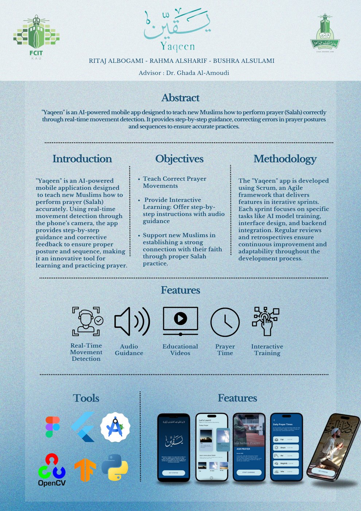

# Yaqeen (يقين) — Prayer Posture Recognition

**Yaqeen** is an AI-powered mobile app that helps new Muslims learn to perform prayer (Salah) correctly. It recognises the worshipper's posture from the phone camera or an uploaded photo and gives step-by-step guidance and corrective feedback.

Published at IEEE AICCSA 2025: *"Yaqeen: A Mobile-Based Deep Learning Framework for Prayer Posture Recognition."*

<p align="center"></p>

## The model

- **VGG16 with transfer learning**, fine-tuned to classify four prayer postures: **Qiam** (standing), **Ruku** (bowing), **Sujud** (prostration) and **Sitting**.
- **95% accuracy** on the test set.
- Exported to TensorFlow Lite (`assets/model.tflite`) and run on the device.

## App features

- Posture recognition from the camera or from an uploaded image, with an audio alert on a wrong posture
- Step-by-step guidance for each of the five daily prayers
- Educational videos
- Daily prayer times

## Run it

```bash
flutter create .     # generates the platform folders
flutter pub get
flutter run
```

## Project layout

```
lib/
  main.dart, welcome_screen.dart     app entry and onboarding
  prayer_home_page.dart              prayers, guidance and videos
  camera_screen.dart, upload_image_page.dart
  model_service.dart                 loads model.tflite and classifies a posture
  prayer_times.dart
assets/
  model.tflite, labels.txt           trained posture classifier (4 classes)
```

## Team

Graduation project, Faculty of Computing and Information Technology, King Abdulaziz University (2025).

- **Ritaj Albogami**
- Rahma Alsharif
- Bushra Alsulami

Advisor: Dr. Ghada Al-Amoudi

**Tech:** Python · TensorFlow / Keras · VGG16 · OpenCV · TensorFlow Lite · Flutter · Dart
